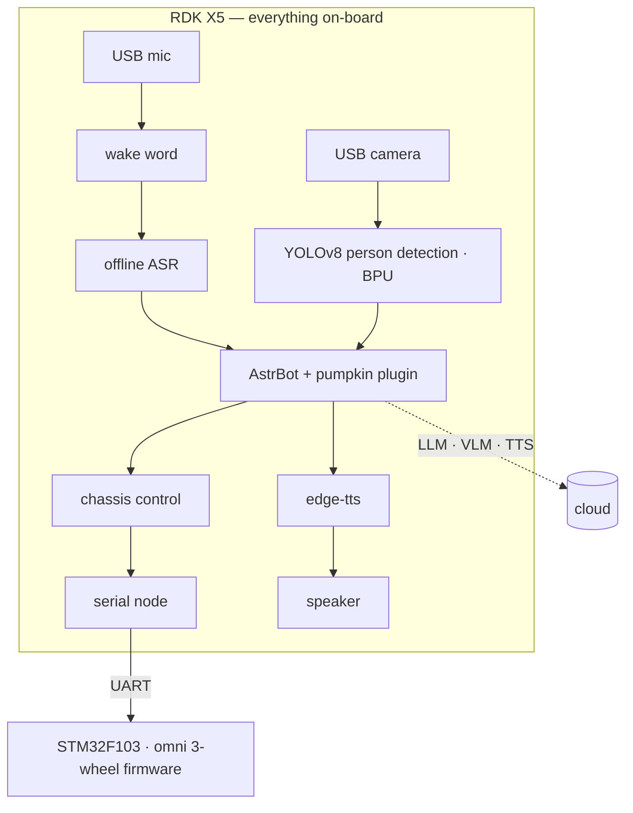

# Pumpkin — a talking, seeing, omnidirectional pumpkin companion

## Project overview

Pumpkin is a real pumpkin turned into a robot, built around a single RDK X5 that carries all hearing, vision, and motion control on-board. She runs a full voice loop (wake word → offline ASR → LLM → TTS), sees people with a fine-tuned YOLOv8 detector on the BPU, and drives an omnidirectional 3-wheel base straight from conversation — there is no remote control and no fixed command list; she decides for herself when and how to move. Ask her to dance and she spins and finds her way back; ask her what she sees and she looks through her own camera and tells you, in Chinese or English.

## Links

- Repository: https://github.com/YeJiAce/pumpkin-robot
- Demo video: https://www.bilibili.com/video/BV1XHsX6NE7K/
- Creator / team: YeJi
- Creator profile: https://github.com/YeJiAce
- Source license: MIT

## Features

- **Talk** — always-on wake word ("nán guā"), offline speech recognition (sherpa-onnx paraformer, dedicated Chinese and English models), LLM-driven conversation with her own personality, and expressive voice via edge-tts.
- **Move** — her chat brain drives an omnidirectional 3-wheel base through tool calls: closed-loop moves, dance-then-return-home, and a hard e-stop for safety.
- **See** — a fine-tuned YOLOv8 person/feet detector runs on the BPU; she narrates what her camera sees through a VLM, and serves a live annotated MJPEG preview.
- **One board, whole robot** — hearing, vision, and motion all run on the RDK X5; the cloud is only used for the LLM, VLM, and TTS. No laptop riding along.

## How RDK X5 is used

- **BPU**: quantized YOLOv8 person/feet detection at camera rate (`robot-x5/vision/pumpkin_v2.bin`).
- **CPU**: sherpa-onnx zipformer keyword spotter (wake word) + paraformer ASR (zh and en models), USB mic captured at native 48 kHz.
- **ROS 2 Humble (TROS)**: a serial node bridges chassis topics to a UART protocol (`docs/PROTOCOL_UART.md`) with heartbeat, session tokens, and host-side motion clamps.
- **Docker on-device**: AstrBot + custom `astrbot_plugin_pumpkin` as the LLM agent brain, with tool calls for motion and camera.
- **Peripherals**: USB camera (MJPG), USB microphone, powered speaker; live MJPEG preview server on port 8080.

## System architecture

## Bill of materials / BOM

| Item | Quantity | Notes |
| --- | ---: | --- |
| RDK X5 | 1 | voice, vision, agent, motion control |
| Real pumpkin (carved shell) | 1 | the body — the pumpkin is the robot |
| STM32F103 board | 1 | motor control firmware (`firmware/`) |
| DC gear motor + encoder | 3 | omni drive |
| Omnidirectional wheel | 3 | 120° layout |
| USB camera | 1 | MJPG |
| USB microphone | 1 | records native 48 kHz |
| Powered speaker | 1 | TTS playback |
| Battery pack | 1 | powers base + X5 |

## Build notes

The STM32F103 firmware (C, CMake) implements omni kinematics, per-wheel speed PI, IMU yaw control, and a safety-checked UART protocol (heartbeat + session tokens; the MCU hard-rejects out-of-range speeds). On the X5, a Python voice front end (`robot-x5/pumpkin_voice.py`) handles wake word, ASR, TTS, and motion clamping; AstrBot in Docker hosts the LLM agent with a custom plugin; a ROS 2 serial node (`robot-x5/pumpkin_serial_node.py`) is the only path to the motors. Training scripts for the person/feet detector are in `training/` in the repository. Full details: [README](https://github.com/YeJiAce/pumpkin-robot#readme).

## Setup and run

See [Getting started](https://github.com/YeJiAce/pumpkin-robot#getting-started) in the repository. Short version: flash `firmware/`, install sherpa-onnx / ffmpeg / edge-tts on the X5, drop in the ASR & KWS models, run AstrBot with the plugin, start the serial node and `pumpkin_voice.py`, then say the wake word.

## Known limitations and safety

- Motion is clamped at multiple layers: host-side caps on move segments/distance/turn angle, plus MCU-side rejection — plus a hard e-stop.
- The wake word is Chinese ("nán guā"); an English wake word is future work. English *responses* and a dedicated English ASR model are supported via a `-en` flag.
- LLM, VLM, and TTS require cloud access; hearing, vision, and motion are fully on-device.
- No obstacle avoidance — the demo runs in a cleared space.
- The USB microphone must be recorded at its native 48 kHz; resampling at capture degrades ASR accuracy.

## Future ideas

- Fully local TTS (a first attempt at the shipped hobot_tts model hit a broken phone-map in the package).
- English wake word; obstacle avoidance; longer autonomous behaviors.

## License

MIT — see [LICENSE](https://github.com/YeJiAce/pumpkin-robot/blob/main/LICENSE).

---

I confirm that I have the right to submit this project profile and allow D-Robotics to use it, with creator attribution, for challenge review, showcase, and community promotion. The project source code remains governed by the license in the linked source repository.
